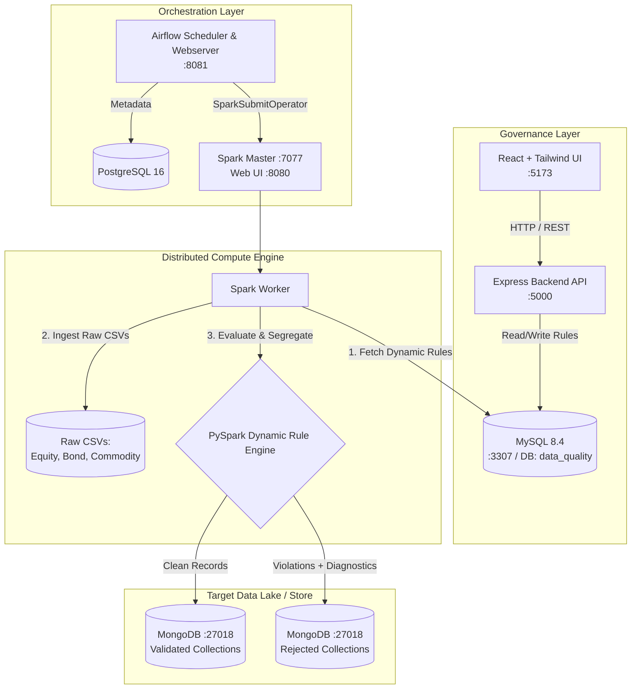

# 🛡️ Data Quality Pipeline

[](https://spark.apache.org/)
[](https://airflow.apache.org/)
[](https://www.docker.com/)
[](https://react.dev/)
[](https://nodejs.org/)
[](https://www.mysql.com/)
[](https://www.mongodb.com/)

A distributed, metadata-driven **Data Quality & Validation Pipeline** designed to ingest, validate, isolate, and audit financial transaction records (**Equity Trades**, **Bond Trades**, and **Commodity Trades**).

Validation rules are dynamically managed via a modern **React Web Dashboard** and **Express REST API**, stored in **MySQL**, executed concurrently across an **Apache Spark Cluster**, orchestrated seamlessly by **Apache Airflow**, and segregated into **Validated** and **Rejected** collections in **MongoDB** with granular error attribution.

---

## 📑 Table of Contents

- [Core Features](#-core-features)
- [Architecture & Data Flow](#-architecture--data-flow)
- [Tech Stack](#-tech-stack)
- [Directory Structure](#-directory-structure)
- [Prerequisites](#-prerequisites)
- [Step-by-Step Installation & Setup](#-step-by-step-installation--setup)
  - [1. Clone Repository](#1-clone-repository)
  - [2. Environment Configuration](#2-environment-configuration)
  - [3. Start Infrastructure via Docker Compose](#3-start-infrastructure-via-docker-compose)
  - [4. Start Backend API](#4-start-backend-api)
  - [5. Start Frontend Web Dashboard](#5-start-frontend-web-dashboard)
- [How to Use the Pipeline (Step-by-Step)](#-how-to-use-the-pipeline-step-by-step)
  - [Step 1: Configure Rules in Web UI](#step-1-configure-rules-in-web-ui)
  - [Step 2: Trigger Orchestration in Airflow](#step-2-trigger-orchestration-in-airflow)
  - [Step 3: Monitor Spark Execution](#step-3-monitor-spark-execution)
  - [Step 4: Verify Segregated Data in MongoDB](#step-4-verify-segregated-data-in-mongodb)
- [Validation Engine Mechanics](#-validation-engine-mechanics)
- [REST API Reference](#-rest-api-reference)
- [Service Ports & Credentials Summary](#-service-ports--credentials-summary)
- [Troubleshooting & FAQ](#-troubleshooting--faq)

---

## 🌟 Core Features

- **Dynamic Rule Engine:** Business rules (e.g., `price > 0`, `quantity >= 1`, `symbol IS NOT NULL`) are managed dynamically at runtime from the UI/database without touching or redeploying Spark jobs.
- **Distributed Big Data Processing:** Uses PySpark on an Apache Spark Master/Worker cluster for high-throughput batch validation.
- **Granular Multi-Failure Aggregation:** When a row violates multiple rules, Spark aggregates all failed rule names and columns into list attributes (`Failed_rules` and `Failed_columns`) using `monotonically_increasing_id()` and `collect_list()`.
- **Automated Airflow Orchestration:** End-to-end DAG `validate_all_trades_pipeline` sequences Equity, Bond, and Commodity validations using `SparkSubmitOperator`.
- **Dual Data Isolation:** Clean records are written to validated collections, while corrupted records are routed with diagnostics to rejected collections in MongoDB.
- **Full-Stack Governance Portal:** Intuitive React + Tailwind CSS dashboard providing rule authoring, active/inactive toggles, dataset inspection, and execution tracking.

---

## 🏗️ Architecture & Data Flow



### Complete Lifecycle
1. **Rule Authoring:** Data engineers or compliance officers create/update rules in the React UI. Changes persist to MySQL (`validation_rules` table).
2. **Scheduled / Manual Trigger:** Airflow DAG `validate_all_trades_pipeline` triggers PySpark applications.
3. **Rule Loading:** PySpark connects via JDBC to MySQL and loads only active rules for the corresponding dataset.
4. **Validation Execution:** Spark parses rules into column expressions, applies them against raw CSV data in parallel, and tags invalid rows.
5. **NoSQL Persistence:** Clean data is stored in MongoDB validated collections, while invalid data is persisted with failure metadata in rejected collections.

---

## 🧰 Tech Stack

| Layer | Technologies |
|---|---|
| **Distributed Compute** | Apache Spark 4.1.1 (PySpark), Spark Master & Worker Cluster |
| **Orchestration** | Apache Airflow 2.10.4, LocalExecutor, SparkSubmitOperator |
| **Rule & Metadata DB** | MySQL 8.4 (`data_quality` schema), PostgreSQL 16 (Airflow DB) |
| **Target Storage** | MongoDB 8.0 (NoSQL document store for clean & rejected data) |
| **Backend API** | Node.js, Express.js 5, `mysql2`, CORS, Dotenv, Nodemon |
| **Frontend UI** | React 18, Vite, Tailwind CSS, Lucide React, React Router v6 |
| **Connectors & Drivers** | Mongo Spark Connector 10.4.1, MySQL Connector/J 9.3.0, BSON 5.2.1 |
| **Containerization** | Docker, Docker Compose |

---

## 📁 Directory Structure

```text
Data-Quality-Pipeline/
├── airflow/
│   ├── config/                  # Airflow custom configurations
│   ├── dags/
│   │   └── validate_all_trades_dag.py   # Main Airflow DAG orchestrating all 3 jobs
│   ├── logs/                    # Execution logs for DAG runs and tasks
│   └── plugins/                 # Custom Airflow plugins (if any)
├── apps/                        # PySpark validation scripts executed on Spark
│   ├── validate_equity.py       # Validates Equity trades dataset
│   ├── validate_bond.py         # Validates Bond trades dataset
│   └── validate_commodity.py    # Validates Commodity trades dataset
├── backend/                     # Node.js Express REST API
│   ├── config/                  # MySQL connection pool
│   ├── controllers/             # Rule & Dataset controllers
│   ├── middleware/              # Global error handling middleware
│   ├── models/                  # Database queries (CRUD on validation_rules)
│   ├── routes/                  # Express route definitions (/rules, /dataset)
│   ├── services/                # Business logic services
│   ├── server.js                # Server entry point (port 5000)
│   └── package.json
├── data/
│   └── raw/                     # Raw input CSV datasets
│       ├── equity_trades.csv
│       ├── bond_trades.csv
│       └── commodity_trades.csv
├── Frontend/                    # React + Vite + Tailwind CSS Web Portal
│   ├── public/
│   ├── src/
│   │   ├── api/                 # Axios/Fetch API wrappers (client, rules, datasets)
│   │   ├── components/          # Reusable UI components (Sidebar, Topbar, Badges)
│   │   ├── pages/               # Pages (Dashboard, ValidationRules, Datasets, etc.)
│   │   ├── App.jsx              # Application router
│   │   └── main.jsx
│   ├── package.json
│   └── vite.config.js
├── mysql/
│   └── init.sql                 # Database initialization script (schema & seed data)
├── docker-compose.yml           # Multi-container orchestration specification
├── Dockerfile.airflow           # Custom Airflow image with Java & Mongo/MySQL JARs
├── dockerfile                   # Custom Spark image with Mongo & MySQL JARs
└── README.md                    # Project documentation
```

---

## ⚙️ Prerequisites

Before getting started, ensure you have the following installed on your machine:

1. **Docker Desktop** (version 24.0+ recommended) & **Docker Compose** (v2+)
   - Allocate at least **6 GB - 8 GB RAM** to Docker for running Spark + Airflow + MySQL + Mongo + Postgres simultaneously.
2. **Node.js** (v18.x or v20.x LTS) & **npm** (v9+)
3. **Git**
4. Optional: **MongoDB Compass** or `mongosh` for visual data verification.
5. Optional: **DBeaver** or MySQL Workbench for inspecting MySQL tables.

---

## 🚀 Step-by-Step Installation & Setup

### 1. Clone Repository

```bash
git clone https://github.com/Darshbhesaniya/Data-Quality-Pipeline.git
cd Data-Quality-Pipeline
```

---

### 2. Environment Configuration

#### Backend Configuration
The backend comes pre-configured to connect to MySQL running via Docker on port `3307`. Verify or edit [`backend/.env`](file:///d:/Data-Quality-Pipeline/backend/.env):

```env
DB_HOST=127.0.0.1
DB_PORT=3307
DB_NAME=data_quality
DB_USER=dq_user
DB_PASSWORD=dq_password
PORT=5000
```

#### Frontend Configuration
Verify or edit [`Frontend/.env`](file:///d:/Data-Quality-Pipeline/Frontend/.env):

```env
VITE_API_BASE_URL=http://localhost:5000
```

---

### 3. Start Infrastructure via Docker Compose

Run the following command in the **root folder**:

```bash
docker compose up -d --build
```

#### What happens behind the scenes:
1. Builds the custom Spark image with Maven connector JARs (MongoDB connector, MySQL connector, BSON codecs).
2. Builds the custom Airflow image with Java JRE and Spark client libraries.
3. Initializes Postgres metadata and executes `airflow db migrate`.
4. Creates default Airflow admin user (`admin` / `admin`).
5. Initializes MySQL database `data_quality` and runs [`mysql/init.sql`](file:///d:/Data-Quality-Pipeline/mysql/init.sql) to create tables and seed default rules.
6. Starts Spark Master, Spark Worker, MongoDB, MySQL, Airflow Webserver, and Airflow Scheduler.

#### Verify containers are healthy:
```bash
docker compose ps
```

You should see 7 running services:
- `spark-master`
- `spark-worker`
- `mongodb`
- `airflow-postgres`
- `airflow-webserver`
- `airflow-scheduler`
- `mysql`

---

### 4. Start Backend API

In a new terminal window:

```bash
cd backend
npm install
npm start
```

Expected output:
```text
✅ MySQL Connected Successfully
🚀 Server is running on port 5000
```

---

### 5. Start Frontend Web Dashboard

In another terminal window:

```bash
cd Frontend
npm install
npm run dev
```

Expected output:
```text
  VITE v5.3.1  ready in 240 ms

  ➜  Local:   http://localhost:5173/
  ➜  Network: use --host to expose
```

Open **`http://localhost:5173`** in your browser to view the Governance Dashboard!

---

## 🎮 How to Use the Pipeline (Step-by-Step)

### Step 1: Configure Rules in Web UI

1. Navigate to **`http://localhost:5173/validation-rules`**.
2. Select a dataset from the dropdown (**Equity Trades**, **Bond Trades**, or **Commodity Trades**).
3. Select the target column (e.g., `price`, `quantity`, `symbol`).
4. Choose an operator:
   - Numerical / Comparison: `>`, `>=`, `<`, `<=`, `==`, `!=`
   - Null checks: `IS NOT NULL`, `IS NULL`
5. Provide a threshold rule value (e.g. `0` for `price > 0`) and a human-readable error message.
6. Click **Create Rule**.
7. The rule is immediately saved to MySQL and ready for the next pipeline run!

---

### Step 2: Trigger Orchestration in Airflow

1. Open the Airflow Web UI at **`http://localhost:8081`**.
2. Log in with:
   - **Username:** `admin`
   - **Password:** `admin`
3. Locate the DAG named **`validate_all_trades_pipeline`**.
4. Unpause the DAG (toggle the switch on the left to **Active**).
5. Click the **Trigger DAG** button (▶ icon on the right).

```text
[validate_equity_trades] ──▶ [validate_bond_trades] ──▶ [validate_commodity_trades]
```

---

### Step 3: Monitor Spark Execution

1. Check real-time task logs directly in Airflow:
   - Click on `validate_equity_trades` -> **Logs**.
2. Open the **Spark Master Web UI** at **`http://localhost:8080`**.
3. View running and completed Spark applications:
   - `Equity Trade Validation`
   - `Bond Validation`
   - `Commodity Validation`
4. Inspect execution metrics, executors, memory footprint, and processing duration.

---

### Step 4: Verify Segregated Data in MongoDB

Once the Airflow pipeline finishes successfully, check MongoDB using Compass or terminal:

**Connection String:** `mongodb://localhost:27018`

```bash
# Connect using mongosh
mongosh --port 27018
```

#### 1. Equity Trades Verification
```javascript
use equity_db

// Count clean vs rejected records
db.validated_trades.countDocuments()
db.rejected_trades.countDocuments()

// Inspect a rejected trade record
db.rejected_trades.findOne()
```

Sample output of a rejected document showing rule failure attribution:
```json
{
  "_id": { "$oid": "664c1234abcd5678ef901234" },
  "trade_id": "TRD202605000042",
  "symbol": null,
  "quantity": -50,
  "price": 102.5,
  "Failed_rules": ["Equity Valid Symbol", "Equity Positive Quantity"],
  "Failed_columns": ["symbol", "quantity"]
}
```

#### 2. Bond Trades Verification
```javascript
use bond_data
db.bond_validated.countDocuments()
db.bond_rejected.countDocuments()
```

#### 3. Commodity Trades Verification
```javascript
use commodity_data
db.commodity_validated.countDocuments()
db.commodity_rejected.countDocuments()
```

---

## 🧠 Validation Engine Mechanics

The PySpark validation scripts ([`apps/validate_equity.py`](file:///d:/Data-Quality-Pipeline/apps/validate_equity.py), [`validate_bond.py`](file:///d:/Data-Quality-Pipeline/apps/validate_bond.py), [`validate_commodity.py`](file:///d:/Data-Quality-Pipeline/apps/validate_commodity.py)) execute the following dynamic logic:

### 1. Condition Builder
Translates dynamic database rows into native Spark SQL column expressions:
```python
def build_condition(rule):
    column_name = rule.column_name
    operator = rule.operator
    rule_value = parse_rule_value(rule.rule_value)

    if operator == ">":       return col(column_name) > rule_value
    elif operator == ">=":    return col(column_name) >= rule_value
    elif operator == "<":     return col(column_name) < rule_value
    elif operator == "<=":    return col(column_name) <= rule_value
    elif operator == "==":    return col(column_name) == rule_value
    elif operator == "!=":    return col(column_name) != rule_value
    elif operator == "IS NULL":     return col(column_name).isNull()
    elif operator == "IS NOT NULL": return col(column_name).isNotNull()
```

### 2. Multi-Failure Aggregation
Rather than rejecting a row on the first failed check, the pipeline tags every violation per row:
```python
# Add unique surrogate key
df = df.withColumn("row_id", monotonically_increasing_id())

# Collect all failures
for rule in rules:
    condition = build_condition(rule)
    failed_df = df.filter(~condition) \
                  .withColumn("Failed_rule", lit(rule.rule_name)) \
                  .withColumn("failed_Column", lit(rule.column_name))
    failed_rule_dfs.append(failed_df)

# Union and group by row_id to aggregate errors
all_failed_df = reduce(lambda df1, df2: df1.unionByName(df2), failed_rule_dfs)
aggregated_failures = all_failed_df.groupBy("row_id").agg(
    collect_list("Failed_rule").alias("Failed_rules"),
    collect_list("failed_Column").alias("Failed_columns")
)

# Join failures back to invalid rows
invalid_df = df.filter(~final_condition).join(aggregated_failures, on="row_id", how="left").drop("row_id")
```

---

## 📡 REST API Reference

The backend runs at `http://localhost:5000`.

### Rules Endpoints

| Method | Endpoint | Description |
|---|---|---|
| `GET` | `/rules` | Fetch all validation rules |
| `POST` | `/rules` | Create a new validation rule |
| `PUT` | `/rules/:id` | Update an existing rule by ID |
| `DELETE` | `/rules/:id` | Delete a validation rule by ID |

#### Example: Create Rule (`POST /rules`)
**Request Body:**
```json
{
  "rule_name": "Equity Minimum Trade Value",
  "dataset": "Equity Trades",
  "column_name": "trade_value",
  "operator": ">=",
  "rule_value": "100",
  "error_message": "Trade value must be at least 100",
  "is_active": true
}
```

**Response (201 Created):**
```json
{
  "success": true,
  "message": "Rule created successfully",
  "data": {
    "id": 11,
    "rule_name": "Equity Minimum Trade Value",
    "dataset": "Equity Trades",
    "column_name": "trade_value",
    "operator": ">=",
    "rule_value": "100",
    "error_message": "Trade value must be at least 100",
    "is_active": true
  }
}
```

### Dataset Metadata Endpoints

| Method | Endpoint | Description |
|---|---|---|
| `GET` | `/dataset` | List all registered datasets |
| `GET` | `/dataset/columns?dataset=<name>` | Get list of columns for a specific dataset |

---

## 🔌 Service Ports & Credentials Summary

| Service | Host Port | Container Port | Credentials / Notes |
|---|---|---|---|
| **Frontend UI** | `5173` | `5173` | Web portal access |
| **Backend REST API** | `5000` | `5000` | Express REST server |
| **Airflow Webserver** | `8081` | `8080` | User: `admin` / Password: `admin` |
| **Spark Master UI** | `8080` | `8080` | Cluster monitor & job tracker |
| **Spark Master RPC** | `7077` | `7077` | `spark://spark-master:7077` |
| **MySQL Database** | `3307` | `3306` | User: `dq_user` / Pass: `dq_password` / DB: `data_quality` (Root: `root`) |
| **MongoDB** | `27018` | `27017` | Databases: `equity_db`, `bond_data`, `commodity_data` |
| **PostgreSQL** | Internal | `5432` | User: `airflow` / Pass: `airflow` / DB: `airflow` |

---

## 🛠️ Troubleshooting & FAQ

### 1. Port 8080 already in use
- Port `8080` is assigned to the Spark Master UI, while Airflow Webserver is bound to host port `8081`.
- If another service (like Oracle, Jenkins, or Tomcat) is using `8080`, change `8080:8080` under `spark-master` in [`docker-compose.yml`](file:///d:/Data-Quality-Pipeline/docker-compose.yml) to e.g. `8085:8080`.

### 2. MySQL Port Conflict (Port 3306)
- This project maps MySQL to host port **`3307`** (`3307:3306`) specifically to prevent collisions with any local MySQL installation.
- Ensure your backend [`.env`](file:///d:/Data-Quality-Pipeline/backend/.env) has `DB_PORT=3307`.

### 3. Airflow Tasks Fail Connecting to Spark
- Verify the Spark connection in Airflow. It is configured automatically in `docker-compose.yml` via:
  ```env
  AIRFLOW_CONN_SPARK_DEFAULT: "spark://spark-master:7077"
  ```
- Ensure `spark-master` is healthy before triggering the DAG.

### 4. Need a Clean Slate / Reset All Databases?
To tear down all containers and wipe volume data (MongoDB, MySQL, Postgres):
```bash
docker compose down -v
docker compose up -d --build
```
*Note: This will re-initialize the databases and re-run [`mysql/init.sql`](file:///d:/Data-Quality-Pipeline/mysql/init.sql).*

---

## 🤝 Contributing

Contributions, bug reports, and feature suggestions are welcome!
1. Fork the Project.
2. Create your Feature Branch (`git checkout -b feature/NewQualityCheck`).
3. Commit your Changes (`git commit -m 'Add new statistical validation rule'`).
4. Push to the Branch (`git push origin feature/NewQualityCheck`).
5. Open a Pull Request.

---
